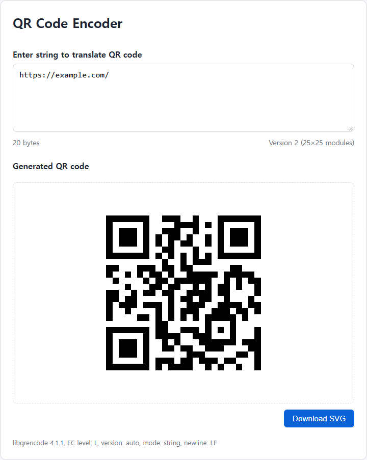

# QR Code Encoder

사용자가 입력한 텍스트(여러 줄 가능)를 [libqrencode](https://github.com/fukuchi/libqrencode) **4.1.1**로 QR 코드로 인코딩하고, 결과를 SVG로 웹 페이지에 실시간으로 표시하는 서비스이다.  
Claude Code로 바이브 코딩하였다.

## 디렉토리/파일 구조

```sh
├── app
│   ├── static
│   │   ├── app.js              Frontend 로직
│   │   ├── index.html          UI
│   │   └── style.css           테마
│   ├── __init__.py
│   ├── envfile.py              env 파일 파싱
│   ├── main.py                 FastAPI 엔드포인트 (/, /api/encode, /api/info)
│   └── qrencode.py             libqrencode ctypes 바인딩 + SVG 생성
├── deploy
│   ├── nginx.conf              리버스 프록시 + 속도 제한
│   └── qrencoder.env           QR 인코딩 파라미터 설정
├── scripts
│   └── build_libqrencode.sh    libqrencode 4.1.1 소스 빌드 → vendor/libqrencode
└── tests
    ├── test_encode.py
    └── test_envfile.py
```

## 인코딩 파라미터

`deploy/qrencoder.env` 파일에서 아래와 같이 설정한다.

| 변수             | 기본값   | 설명 |
| :--------------: | :------: | ---- |
| QR_LEVEL         | `L`      | 오류 정정 레벨 `L/M/Q/H` |
| QR_VERSION       | `0`      | `0`=자동, `1~40`=고정 |
| QR_MODE          | `string` | `string`, `8bit`, `kanji` |
| QR_CASESENSITIVE | `1`      | 대소문자 구분 여부 (`1`=구분, `0`=구분하지 않음) |
| QR_NEWLINE       | `lf`     | 인코더에 전달할 줄바꿈: `lf` / `crlf` / `keep` |
| QR_MARGIN        | `4`      | 여백(표시용, QR 코드에는 영향 없음) |
| MAX_INPUT_BYTES  | `4096`   | 입력 최대 바이트 |
| WELCOME_MESSAGE  |          | 페이지 상단 문구. 없거나 비어 있으면 표시하지 않음 |

> 기본값은 `qrencode` CLI 툴의 기본값과 같도록 설정하였다.

## 로컬 개발

사전에 아래와 같이 필요한 패키지를 설치한다.
```sh
sudo apt install build-essential cmake libpng-dev pkg-config python3 python3-venv
```
Git clone 후 아래와 같이 빌드 및 실행시킬 수 있다. (아래 예에서 포트는 8000번 사용)
```sh
git clone https://github.com/yrpark99/QrCodeEncoder.git
cd QrCodeEncoder/
./scripts/build_libqrencode.sh
python3 -m venv .venv && .venv/bin/pip install -r requirements-dev.txt
.venv/bin/uvicorn app.main:app --reload --host 0.0.0.0 --port 8000
```

이후 웹브라우저에서 해당 서버주소의 포트 번호로 접속하여 아래 캡쳐 예와 같이 QR code를 얻을 수 있다. (`Download SVG` 버튼을 누르면 SVG 파일로 다운로드 받을 수도 있음)  


## API

- **POST /api/encode**  
  JSON으로 텍스트를 받아 QR 코드를 SVG 이미지로 돌려준다.
  ```sh
  POST /api/encode
  Content-Type: application/json

  {"text": "인코딩할 문자열"}
  ```
  > `text`는 UTF-8 기준 `MAX_INPUT_BYTES`(기본 4096바이트) 이하여야 한다. QR 코드의 최대 용량은 약 2953바이트(버전 40, 레벨 L, 8비트)이므로 이를 넘으면 인코딩 오류(400)가 리턴된다.

  성공시 응답 헤더는 다음과 같다.
  - `X-QR-Version`: 실제로 사용된 QR 버전 (1~40)
  - `X-QR-Width`: 한 변의 모듈 수

  사용 예 (curl 이용, 예로 "https://example.com" 문자열에 대한 QR 코드를 요청하여 qrcode.svg 파일로 저장함)
  ```sh
  curl -s -X POST http://서버주소/api/encode \
    -H "Content-Type: application/json" \
    -d '{"text":"https://example.com"}' \
    -o qrcode.svg -D -
  ```
- **GET /api/info**  
  아래와 같이 현재 적용된 인코딩 설정(`level`, `version`, `mode`, `casesensitive`, `newline`, `margin`), `max_input_bytes`, `libqrencode` 버전, `welcome` 문구를 JSON으로 돌려준다.
  ```sh
  curl http://서버주소/api/info
  ```
